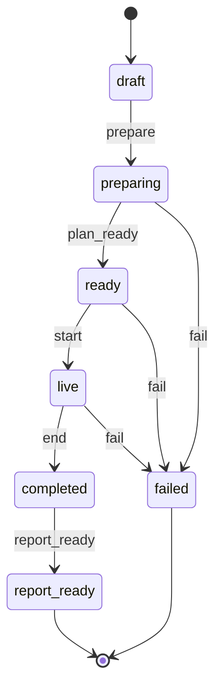

# PracticeRoom

PracticeRoom is a mock-interview platform. A candidate describes a job or a set of skills. The system prepares an interview, asks one question at a time, and keeps a transcript.

The product name in the interface is PracticeRoom. The npm packages are lowercase: `practice-room`, `@practice-room/api`, and `@practice-room/shared-types`.

This README covers the work completed so far. The interview engine runs in memory and is verified by check scripts. Accounts, a database, the website, voice, camera, and a live web search are not built yet.

## What a session does today

1. Accept either a job interview or a skill interview and convert both into one `InterviewConfiguration`.
2. For a job interview, build a public search query per site. A skill interview skips search.
3. Collect those pages through a `SearchProvider`. The current provider returns example links. It does not open the internet.
4. Build a timed interview plan whose sections add up to the requested duration.
5. Ask the first question, ask one follow-up when an answer is shorter than 40 characters, then move to the next section.
6. Store each prompt and answer. When the last section is answered, the session status becomes `completed`.

A technical interview has three sections: Background, Core concepts, and Follow-ups. A short answer stays in the current section. Each later answer moves one section forward. The interview is finished only after the candidate answers the last section.

## Session state machine

`SessionStateMachine` is the only code that changes an interview's status. Any event that is not drawn here throws.



`prepare` runs research and builds the plan. `plan_ready` means the plan exists. `start` asks the first question. `end` is the answer to the last section. `report_ready` is the feedback report. `failed` is allowed from preparation, from the ready plan, or from the live interview. `report_ready` and `failed` have no further moves.

## Repository layout

```text
PracticeRoom/
├── apps/api/                         NestJS API and the interview engine
│   └── src/interviews/               Configuration, research, plan, turns, session
├── apps/web/                         React app, not started
├── apps/ai-service/                  FastAPI agents, not started
├── packages/shared-types/            Types shared by the web app and the API
├── docs/                             PRD, HLD, LLD, API, data, and decisions
├── package.json                      Workspace root
└── pnpm-workspace.yaml               Lists the Node packages
```

`apps/ai-service` is Python, so it is not part of the pnpm workspace.

## Design documents

| Document | What it records |
|---|---|
| [docs/requirements/prd.md](docs/requirements/prd.md) | Candidate flows, interview rules, and feedback rules that are implemented |
| [docs/architecture/hld.md](docs/architecture/hld.md) | Workspace, session flow, and which services are not running yet |
| [docs/lld/interview.md](docs/lld/interview.md) | Status machine, research queries, plan timing, turns, and scoring |
| [docs/api/http.md](docs/api/http.md) | `GET /api/v1/health`, and the interview routes that are not registered |
| [docs/database/schema.md](docs/database/schema.md) | The in-memory session, and the tables planned for later |
| [docs/decisions](docs/decisions) | Why the session is in memory, why search is a provider, and why scores quote answers |

## Setup

Install Node.js LTS and pnpm. This project was built with Node.js 26.13.0 and pnpm 12.18.0. Node 26 does not include Corepack, so pnpm is installed with npm:

```powershell
npm install -g pnpm
pnpm install
```

Run the commands below from the repository root, `HirePro` on this machine.

## Run the API

```powershell
pnpm --filter @practice-room/api start
```

In a second terminal:

```powershell
Invoke-RestMethod http://localhost:3000/api/v1/health
```

The response is `status: ok` and the experience levels `entry`, `mid`, and `senior`. Stop the server with Ctrl+C.

## Check the interview engine

Run these in order. Each script prints one success line. A thrown assertion means that step failed.

```powershell
pnpm --filter @practice-room/shared-types typecheck
node --experimental-strip-types apps/api/src/interviews/session-state.check.ts
node --experimental-strip-types apps/api/src/interviews/configuration.check.ts
node --experimental-strip-types apps/api/src/interviews/research.check.ts
node --experimental-strip-types apps/api/src/interviews/research-service.check.ts
node --experimental-strip-types apps/api/src/interviews/plan.check.ts
node --experimental-strip-types apps/api/src/interviews/interviewer.check.ts
node --experimental-strip-types apps/api/src/interviews/interview-session.check.ts
```

Expected success lines:

```text
session state machine ok
configuration mapping ok
public research queries ok
public research service ok
interview plan ok
interviewer turns ok
interview session ok
```

Node prints a `MODULE_TYPELESS_PACKAGE_JSON` warning before those lines. Leave it. Do not add `"type": "module"` to `apps/api/package.json`. Nest compiles the API as CommonJS, and that field would break `nest start`.

When a check script imports a local file, the import must end in `.ts`, for example `./session-state.ts`. Node is executing the TypeScript source directly. It will not find a `.js` file that was never built.

Do not use a TypeScript parameter property in files run this way. `constructor(private readonly config: InterviewConfiguration)` is rejected in strip-only mode. Declare the field, then assign `this.config = config` inside the constructor. Nest's own compiler accepts the shortcut, but these checks do not use that compiler.

## Steps completed

### 1. Tools

Node.js and pnpm are installed. `pnpm -v` prints `12.18.0`.

### 2. Workspace

The root `package.json` names the workspace `practice-room` and marks it private. `pnpm-workspace.yaml` includes `apps/web`, `apps/api`, and `packages/*`. `.gitignore` excludes `node_modules`, build output, and env files.

### 3. Shared types

`packages/shared-types` holds the interview vocabulary: mode, interview type, experience level, difficulty, job content, and `InterviewConfiguration`. Both a job form and a skill form become that one object.

Check the types with:

```powershell
pnpm --filter @practice-room/shared-types typecheck
```

`typecheck` runs `tsc --noEmit` in that package only. A silent result means the types are valid. TypeScript writes no JavaScript files.

### 4. API health check

`apps/api` is a NestJS application. `main.ts` listens on port 3000 and prefixes routes with `api/v1`. `GET /api/v1/health` returns the shared experience levels, which proves the API can import `@practice-room/shared-types`.

### 5. Session state machine

`apps/api/src/interviews/session-state.ts` allows only these moves:

```text
draft -> preparing -> ready -> live -> completed -> report_ready
```

`preparing`, `ready`, and `live` can also move to `failed`. `report_ready` and `failed` have no further moves. Any other event throws.

Check: `node --experimental-strip-types apps/api/src/interviews/session-state.check.ts`

### 6. One configuration for both forms

`toInterviewConfiguration` in `configuration.ts` accepts `JobInterviewInput` or `SkillInterviewInput`.

A job interview requires a company, role, and description. Its `skills` list stays empty until research can fill it. A skill interview requires at least one non-blank skill and has no `job`. A duration of 0 or less throws.

Check: `node --experimental-strip-types apps/api/src/interviews/configuration.check.ts`

### 7 and 8. Public research queries

For job mode, `buildResearchQueries` creates one query per public site plus one query for the company's own site. The site list is in `research.ts`: LeetCode, Glassdoor, GeeksforGeeks, Medium, Reddit, LinkedIn, AmbitionBox, ZipRecruiter, Stack Overflow, GitHub, IGotAnOffer, Blind, and CareerCup.

Each site query uses a bare domain and no space after `site:`. A Google software-engineer search for Reddit is:

```text
Google Software Engineer interview experience site:reddit.com
```

An optional round is inserted with a leading space, so `Technical` becomes `Google Software Engineer Technical interview experience`. Skill mode returns no queries.

`mockFetchPublicPages` turns each query into an example `ResearchSource`. It does not fetch those websites.

Check: `node --experimental-strip-types apps/api/src/interviews/research.check.ts`

### 9. Search provider and research run

`SearchProvider` has one method, `search(query)`. `MockSearchProvider` implements it with an example page. A later web-search tool can implement the same interface.

`runPublicResearch` asks the provider for every query. It uses `Promise.allSettled`. Each result is one of these two shapes, defined by JavaScript rather than by this project:

```ts
{ status: "fulfilled"; value: ResearchSource[] }
{ status: "rejected"; reason: unknown }
```

A rejected platform is skipped. `result.value` exists only after `result.status === "fulfilled"`. Duplicate URLs are removed. Skill mode returns an empty list.

Check: `node --experimental-strip-types apps/api/src/interviews/research-service.check.ts`

### 10. Interview plan

`buildInterviewPlan` chooses section names from the interview type, splits `durationMinutes` across those sections, and puts any remainder on the last section. A 40-minute coding plan is 13, 13, and 14 minutes. Each section has one question. Job-mode questions keep up to two source URLs. Those pages are preparation material, not a claim about the company's actual questions.

Check: `node --experimental-strip-types apps/api/src/interviews/plan.check.ts`

### 11. Interviewer turns

`firstQuestion` returns the first section's prompt. `nextTurn` looks at the answer and a cursor:

- An answer shorter than 40 characters gets one follow-up, and the section does not change.
- A longer answer, or a second answer after the follow-up, moves to the next section.
- An answer to the last section returns `done: true`.

The 40-character test stands in for a model judging a thin answer. The cursor shape can stay when a model replaces that test.

Check: `node --experimental-strip-types apps/api/src/interviews/interviewer.check.ts`

### 12. Interview session

`InterviewSession` connects the pieces.

| Method | Status change | What it does |
|---|---|---|
| `create` | `draft` | Holds the configuration |
| `prepare` | `draft` to `preparing` to `ready` | Runs research and builds the plan |
| `start` | `ready` to `live` | Asks the first question |
| `answer` | stays `live`, or moves to `completed` | Records the answer and asks the next turn |

`start` throws before `prepare`. `answer` throws unless the status is `live`, including after the interview is completed.

Check: `node --experimental-strip-types apps/api/src/interviews/interview-session.check.ts`

The job session in that check searches with `MockSearchProvider`, so the plan has source URLs. The skill session has none. The candidate gives one short answer and then three long answers, which is what a three-section technical interview needs.

## Not built yet

The next product work is a feedback report from the transcript, then accounts and a database so a session survives a restart. After that comes the React interview screen, microphone and camera permissions, and a real `SearchProvider` that runs the saved queries on the public web.
