# PracticeRoom — full design graph

**Product:** PracticeRoom  
**Repo folder:** HirePro  
**Live production:** https://hirepro-nandini.fly.dev/  
**Related:** [current-state.md](../current-state.md) · [deploy.md](../deploy.md) · design patterns under `.cursor/rules/`

This file is the **whole-system design view**: deployment, packages, request paths, interview state, prepare/live LLM graph, and behavioral arc.

---

## 1. System context

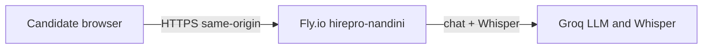

What the candidate’s browser talks to:

- **UI** — React SPA (Kokoro TTS, Silero VAD, Monaco for coding)
- **API** — Nest `/api/v1/*` (cookie auth, SQLite, interview use cases)
- **AI worker** — Python `room_worker` (spawned by Nest; not a separate public URL)

---

## 2. Production deployment graph

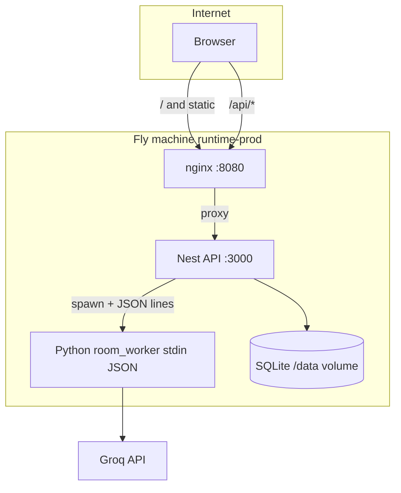

Local Docker Compose is the same idea split into two containers (`web` nginx + `api`), still proxied so the browser can use one origin on `:8080`.

---

## 3. Repository / package graph

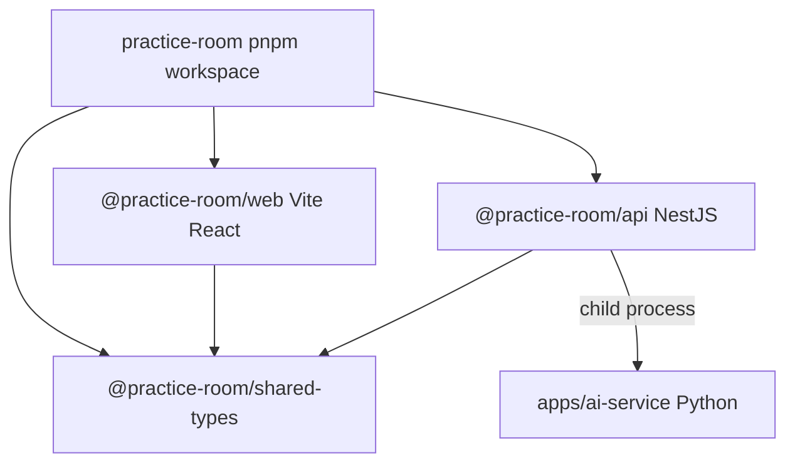

| Path | Responsibility |
|------|----------------|
| `apps/web` | Studio UI, voice, live room, report view |
| `apps/api` | HTTP, auth, SQLite, use cases, Python bridge |
| `apps/ai-service` | Prepare, live reply, evaluate, Whisper, graphs |
| `packages/shared-types` | Interview / feedback TypeScript types |

---

## 4. Design patterns (API)

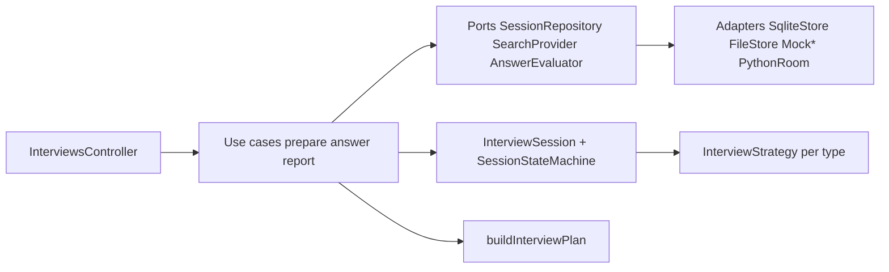

Rules encoded in code:

- **State** — only `SessionStateMachine.transition` changes status (load may assign saved status).
- **Factory** — `InterviewSession.create` / `fromRecord`.
- **Builder** — `buildInterviewPlan`.
- **Strategy** — section names, weights, follow-up claims by `interviewType`.
- **Port / adapter** — controllers depend on ports; Nest module picks adapters.

---

## 5. Session state machine

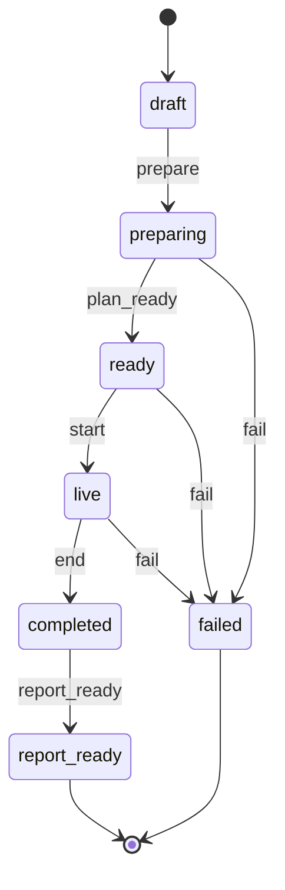

---

## 6. End-to-end candidate journey

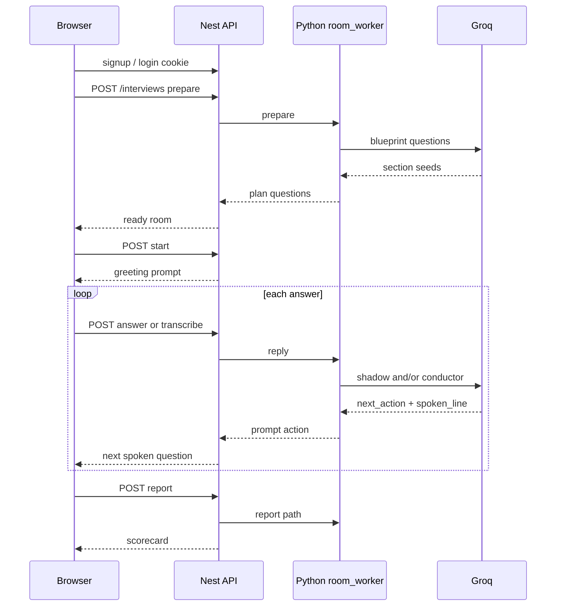

---

## 7. HTTP surface (`/api/v1`)

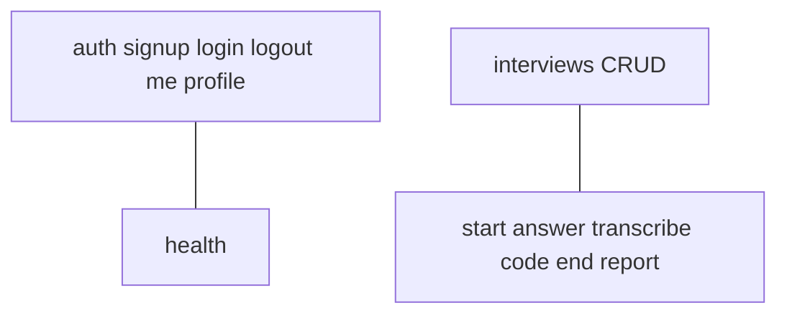

| Area | Routes |
|------|--------|
| Health | `GET /health` |
| Auth | `POST /auth/signup`, `login`, `logout`; `GET /auth/me`; `PATCH /auth/profile` |
| Interviews | `POST/GET /interviews`, `GET/DELETE /:id`, `GET /companies` |
| Live | `POST /:id/start`, `answer`, `transcribe`, `code`, `end`, `report` |

---

## 8. Interview type → section strategy

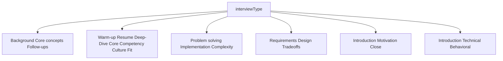

**Behavioral minutes (30‑minute room):** Warm-up **3** · Resume Deep-Dive **8** · Core Competency **14** · Culture Fit **5**.

Timers are **deterministic in Nest** (section budget / soft 80% wrap / hard 100% leave). The LLM does not own the clock.

---

## 9. Prepare graph (before live)

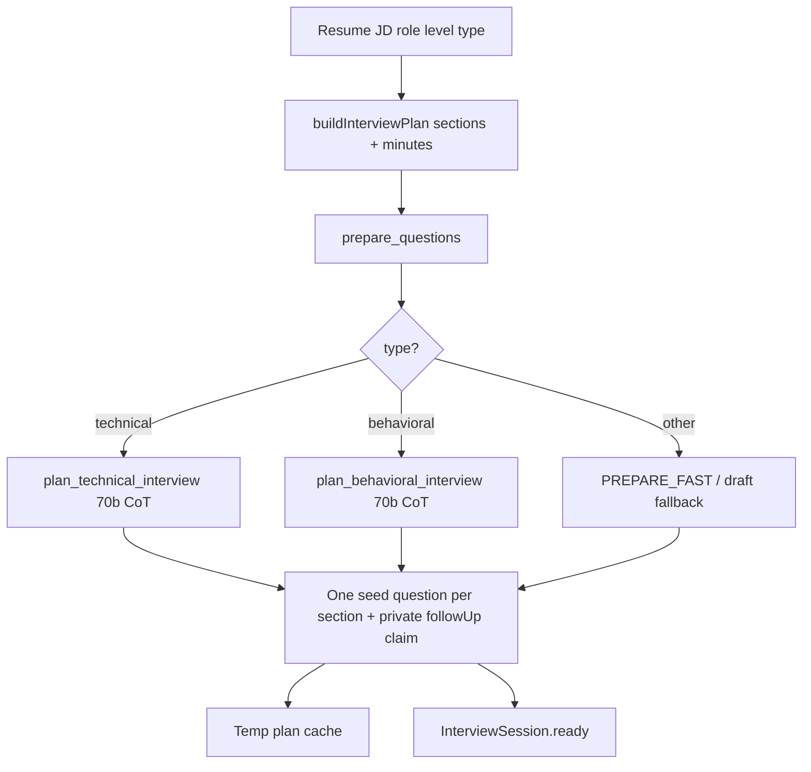

Theme banks (behavioral) inspire questions; they are **not** fixed scripts. Planner uses private `reasoning` (chain-of-thought), then emits spoken seeds.

---

## 10. Live turn graph (Shadow + Conductor)

Used for **technical** and **behavioral** content turns (Nest orchestration + Python reply).

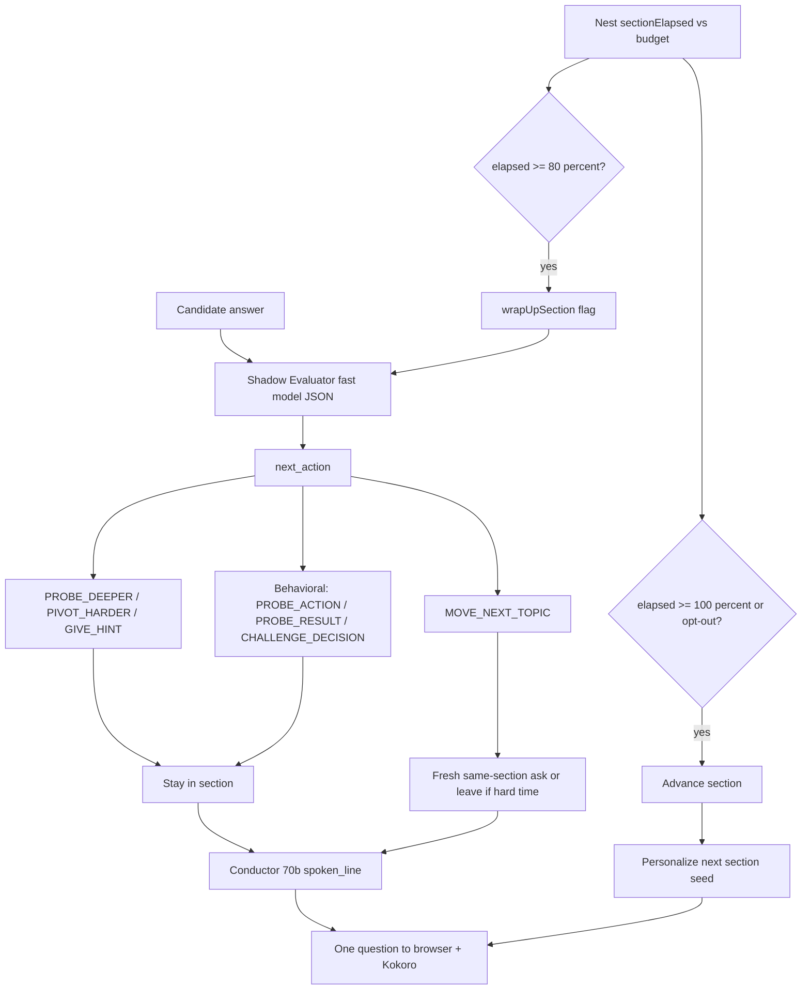

| Role | Model (typical Groq) | Speaks to user? |
|------|----------------------|-----------------|
| Shadow evaluator | 8B structured JSON | No |
| Conductor / live | 70B spoken_line | Yes |
| Background `seed_next` | 8B | Prepares next seed only |

**Conductor rules:** one question per turn; credit one detail from the answer; never recite seeds verbatim; type-lock (no STAR leakage into technical).

---

## 11. Dual-LLM pacing (background prep)

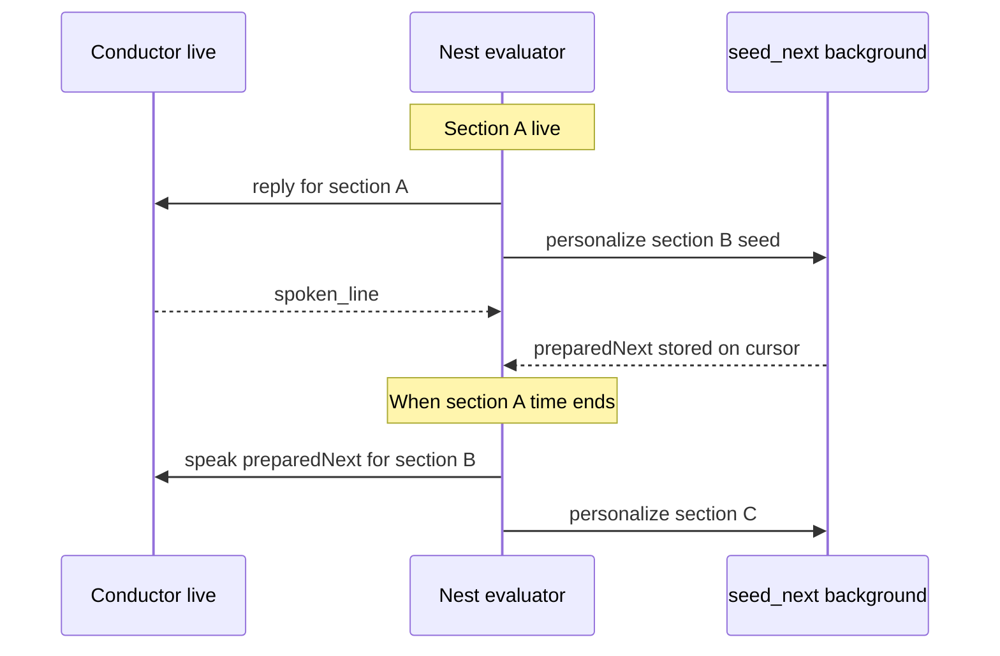

While LLM‑1 (live) is on the current section, LLM‑2 (background) can prepare the next section’s first question from the last answer + plan seed.

---

## 12. Behavioral competency arc

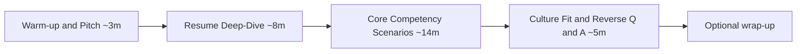

| Section | Theme bank examples (inspiration only) |
|---------|----------------------------------------|
| Warm-up | Pitch, background, motivation, strengths |
| Resume | Internship/project ownership, decisions, learning |
| Core competency | Ownership, disagreement, deadlines, mistakes, feedback |
| Culture fit | Why company, environment, reverse questions |

Shadow checks STAR completeness and pronoun ownership (`I` vs `we`); Conductor probes action/result or transitions.

---

## 13. Data graph

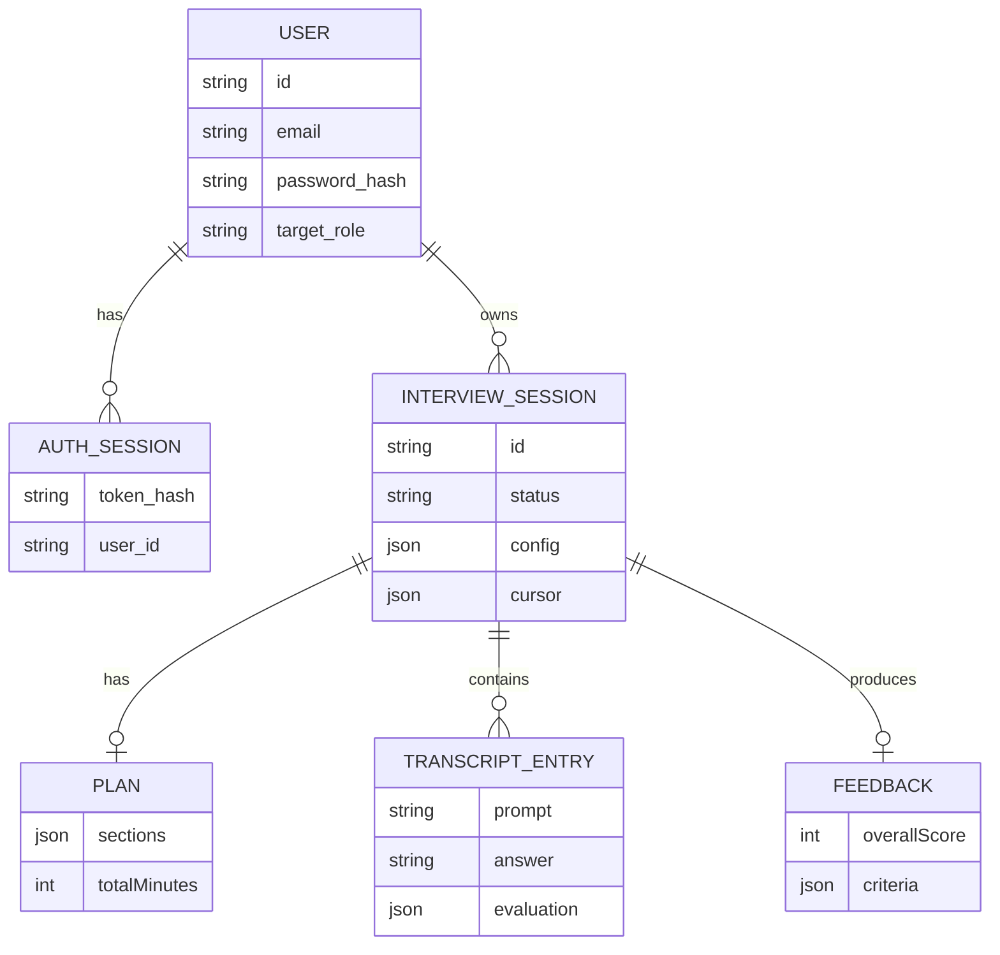

Persistence today: one SQLite file under `PRACTICE_ROOM_DATA_DIR` (Fly volume `/data`).

---

## 14. Voice / media path (browser)

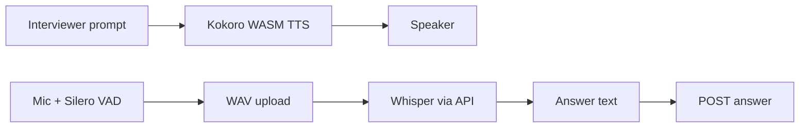

Camera/mic stay in the browser; only audio (or typed text) and code go to the API.

---

## 15. File map (where the graph lives in code)

| Concern | Primary files |
|---------|----------------|
| HTTP + CORS | `apps/api/src/main.ts`, `interviews.controller.ts`, `auth/*` |
| Use cases | `apps/api/src/application/interview/*` |
| Session / state | `interview-session.ts`, `session-state.ts`, `interviewer.ts` |
| Strategy / minutes | `interview-strategy.ts`, `plan.ts` |
| Python bridge | `python-room.ts`, `room_worker.py` |
| Prepare / live | `server.py`, `technical_graph.py`, `behavioral_graph.py` |
| Web live room | `apps/web/src/App.tsx`, `room/*`, `interviewer-voice*` |
| Deploy | `Dockerfile`, `fly.toml`, `deploy/start-prod.sh`, `docs/deploy.md` |

---

## 16. What is intentionally out of band

- No hire/reject badge on the report  
- No scoring of accent, appearance, or emotion  
- Search provider may return empty/local stubs (not a full open-web crawler requirement)  
- LLM never owns wall-clock section timing  

For “what works today” narrative detail, see [current-state.md](../current-state.md). For Fly commands and troubleshooting, see [deploy.md](../deploy.md).
