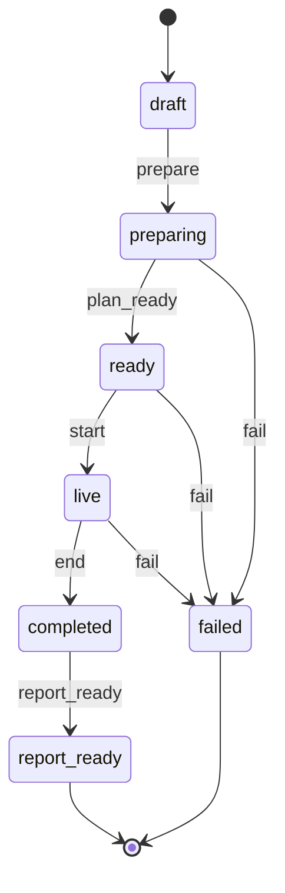

# PracticeRoom — current system documentation

**Last updated:** 28 November 2026  
**Product name:** PracticeRoom  
**Repository folder:** `HirePro`  
**npm scope:** `practice-room`, `@practice-room/web`, `@practice-room/api`, `@practice-room/shared-types`

This document describes **what is built and running in code today**. Older files under `docs/` (PRD, HLD, schema, README intro) may still describe an earlier in-memory / no-accounts slice. Prefer this file for the live system.

---

## 1. What PracticeRoom is

PracticeRoom is a mock-interview platform. A signed-in candidate configures a job or skill interview, the system prepares timed sections and questions, the candidate answers by voice or text (and code for coding rounds), and a transcript-based scorecard is produced.

It is **practice**, not hiring. The report does not recommend hire or reject. Accent, appearance, emotion, and personality are not scored. Camera and microphone stay local to the browser.

---

## 2. Repository layout

```text
HirePro/
├── package.json                 # practice-room, pnpm@12.18.0
├── pnpm-workspace.yaml          # apps/web, apps/api, packages/*
├── .cursor/rules/design-patterns.mdc
├── docs/                        # this file + older architecture notes
├── apps/
│   ├── web/                     # Vite + React SPA (@practice-room/web)
│   ├── api/                     # NestJS API (@practice-room/api)
│   └── ai-service/              # Python interviewer (not in pnpm workspace)
└── packages/
    └── shared-types/            # @practice-room/shared-types
```

| Package | Role |
|---|---|
| `@practice-room/web` | Browser UI, Kokoro TTS, Silero VAD, Monaco coding editor |
| `@practice-room/api` | Nest HTTP API, cookie auth, SQLite, interview lifecycle |
| `@practice-room/shared-types` | Shared TypeScript types |
| `apps/ai-service` | Question prep, live replies, Whisper, reports, plan cache |

---

## 3. Technologies used

### 3.1 Workspace and languages

| Technology | Version / note | Where |
|---|---|---|
| pnpm | 12.18.0 | Root `packageManager` |
| Node.js | Project runs on Node 26 locally | API uses `node:sqlite` |
| TypeScript | Web `~7.0.2`, API `^5.6.3` | `apps/web`, `apps/api`, `packages/shared-types` |
| Python | 3.13 (observed) | `apps/ai-service` |
| MCP Python package | `mcp` in `requirements.txt` | MCP tools still used for some paths |

### 3.2 Web (`apps/web`)

| Technology | Purpose |
|---|---|
| React 19 | UI |
| Vite 8 | Dev server and bundler (port **5173**) |
| `@vitejs/plugin-react` | React transform |
| `kokoro-js` 1.2.1 | Browser TTS (WASM ONNX) |
| ONNX model `onnx-community/Kokoro-82M-v1.0-ONNX` | Voice model, `q8`, voice `af_heart`, pace `0.88` |
| `@ricky0123/vad-web` | Silero VAD turn-taking |
| `@monaco-editor/react` | Coding-round editor |
| `pdfjs-dist` | Resume PDF text extraction (first 4 pages) |
| Web Audio API | Playback of Kokoro buffers |
| `MediaRecorder` / `getUserMedia` | Mic recording and camera preview |
| `SpeechRecognition` (where available) | Live caption assist |
| `window.print` | PDF-style report export |
| Inline SVG / CSS | Charts (no Recharts / Tremor) |

**Not used (deliberately):** Next.js, Prisma, better-sqlite3, Recharts, Tremor, `@react-pdf`, JWT in the browser.

### 3.3 API (`apps/api`)

| Technology | Purpose |
|---|---|
| NestJS 11 | HTTP server (port **3000**, prefix `api/v1`) |
| Express (via Nest) | Body parser limit 12mb for audio |
| `node:sqlite` `DatabaseSync` | SQLite persistence |
| scrypt | Password hashing |
| SHA-256 | Session token digest |
| Cookie `practice_room` | HttpOnly, SameSite=Lax, 14-day Max-Age |
| Child process / long-lived Python | `room_worker.py` for prepare / reply / transcribe / repair |
| CORS | `http://localhost:5173` with `credentials: true` |
| CommonJS emit | Nest stays CommonJS (no `"type": "module"` on API) |

### 3.4 AI service (`apps/ai-service`)

| Technology | Purpose |
|---|---|
| Groq OpenAI-compatible API | Chat + Whisper (`PRACTICE_ROOM_LLM_*` / `PRACTICE_ROOM_GROQ_KEY`) |
| `llama-3.1-8b-instant` | Fast question prep, live reply, repair (on Groq) |
| `llama-3.3-70b-versatile` | Fallback when 8B refuses |
| `whisper-large-v3-turbo` then `whisper-large-v3` | Speech-to-text |
| Land the Lab CSV | Public question bank cache (`%TEMP%/practice-room-landthelab.csv`) |
| Temp JSON plan cache | `%TEMP%/practice-room-plans/{sha256}.json` |
| Temp search cache | `%TEMP%/practice-room-search.json` |
| DuckDuckGo / public pages | Research when search adapter is live (create currently uses empty local search) |
| `r.jina.ai` | Fallback when a pasted URL cannot be read directly |
| MCP server | `draft_questions`, `search_public_web`, `ask_next`, `write_report` |

---

## 4. How the product works end to end

### 4.1 Account and studio

1. Candidate opens `http://localhost:5173`.
2. Signup or login hits Nest auth; cookie `practice_room` is set.
3. First-time profile asks for target role, experience level, and goal (`this_week` | `campus` | `practice`).
4. Lobby (dark studio) shows overview metrics from stored reports, a launcher, and saved interviews (overview shows three, with a link to all).

### 4.2 Prepare an interview

1. Candidate chooses job or skill mode, interview type, duration (≥ 10 minutes), persona, practice mode, optional materials, and (for technical) a resume.
2. `POST /api/v1/interviews` runs `prepareInterview`:
   - Creates `InterviewSession` (factory).
   - Runs `runPublicResearch` through a `SearchProvider` (live create uses `LocalSearchProvider` → no web pages; supplied notes become a single “supplied” source).
   - Calls `McpQuestionAuthor` → warm `room_worker.py` → `prepare_questions`.
   - Builds timed plan via `buildInterviewPlan` (builder + strategy weights).
   - Transitions `draft → preparing → ready`.
3. Session is saved in SQLite with `ownerId`.
4. UI opens **ReadyRoom** (briefing). Enter requests fullscreen, then starts the live room.

### 4.3 Live interview

1. `POST .../start` transitions to `live`, records `startedAt`, and returns the opening turn.
2. Client speaks the greeting with Kokoro (sentence-level, text revealed with audio).
3. Candidate answers:
   - Voice: VAD end → WAV → `POST .../transcribe` → Whisper → `POST .../answer`.
   - Typed (coding doubts / skip): go straight to answer.
4. `answerInterview` + `McpAnswerEvaluator`:
   - Non-coding: polite opt-out or ≥ 2 follow-ups force advance without waiting on the model.
   - Introduction for technical: Python `introduction_reply` (no model) handles name, then ownership opener, then Background.
   - Otherwise `model_reply` on the warm Python worker (short JSON, 4s timeout, stored next question on advance).
5. Session applies the turn through `nextTurn` / cursor; transcript rows store prompt, answer, action, outcome, delivery signals.
6. Clock counts down from `durationMinutes` (client). Server wrap-up reserve still applies when duration is exactly 10 minutes.
7. End or last section → `completed` → report.

### 4.4 Report

1. `POST .../report` calls the report generator (Python / MCP path).
2. Status becomes `report_ready`. Feedback is stored on the session and not regenerated on a second call.
3. UI shows `ReportView` (print-friendly). Pillars are averages of measured content scores; unmeasured metrics show an em dash.

---

## 5. Interview types, sections, and timing

Section names come from `InterviewStrategy`. Minutes come from `allocateMinutes` after subtracting optional intro share.

| Type | Sections | Weights | Intro minutes |
|---|---|---|---|
| **technical** | Background, Core concepts, Follow-ups | 0.28 / **0.44** / 0.28 | ~8% of total, clamped 2–4 (shown as Introduction) |
| **coding** | Problem solving, Implementation, Complexity | equal | none in plan |
| **behavioral** | Introduction, Past experience, Reflection | 0.2 / 0.5 / 0.3 | none extra |
| **system_design** | Requirements, Design, Tradeoffs | 0.25 / 0.45 / 0.3 | ~6%, 2–4 |
| **hr** | Introduction, Motivation, Close | 0.25 / 0.45 / 0.3 | none extra |
| **mixed** | Introduction, Technical, Behavioral | 0.2 / 0.45 / 0.35 | none extra |

**Technical arc (live):**

1. **Introduction** — greet, name, agenda, short ownership opener (communication baseline).
2. **Background** — one resume system: data flow and why that shape.
3. **Core concepts** — largest slot: fundamentals, cost, applied case.
4. **Follow-ups** — one job requirement under a missing detail or failure.

Questions are generated from the form (resume, skills, company, role, job requirement), not a fixed bank. `followUpPrompt` is a private claim for probing, not a second scripted question.

**Experience levels:** `entry` | `mid` | `senior`  
**Difficulty:** `easy` | `medium` | `hard`  
**Personas:** `coach` | `recruiter` | `bar_raiser`  
**Practice modes:** `coach` (hints) | `real` (no hints)  
**Coding languages:** `cpp` | `python` | `typescript` | `c` (runner executes JavaScript only; C/C++/Python show that note without treating it as a solution error)

---

## 6. Session state machine

Only `SessionStateMachine.transition` changes status (except loading a saved record).



Illegal events throw: `Cannot ${event} while the interview is in ${from} state`.

---

## 7. Design patterns (enforced)

From `.cursor/rules/design-patterns.mdc`:

| Pattern | Rule | Primary code |
|---|---|---|
| **State** | Only the state machine changes status | `session-state.ts` |
| **Factory** | `InterviewSession.create` / `fromRecord` | `interview-session.ts` |
| **Builder** | `buildInterviewPlan` | `plan.ts` |
| **Strategy** | One strategy per interview type | `interview-strategy.ts` |
| **Port / adapter** | Use cases depend on ports | Search, QuestionAuthor, AnswerEvaluator, ReportGenerator, SessionRepository, UserRepository |
| **Repository** | Module selects SQLite adapters | `app.module.ts` |
| **Use case** | `prepareInterview`, `answerInterview`, `reportInterview` | `application/interview/*` |

Do not put a second implementation behind a concrete class inside a controller or use case.

---

## 8. HTTP API

Base URL: `http://localhost:3000/api/v1`  
Auth: cookie `practice_room` (except health).

### Auth

| Method | Path | Purpose |
|---|---|---|
| POST | `/auth/signup` | Create account; claim unowned interviews; set cookie |
| POST | `/auth/login` | Login; set cookie |
| POST | `/auth/logout` | Clear cookie |
| GET | `/auth/me` | Current account |
| PATCH | `/auth/profile` | Target role, experience, goal |

### Interviews

| Method | Path | Purpose |
|---|---|---|
| GET | `/health` | Liveness + experience levels |
| POST | `/interviews` | Prepare room (synchronous prepare today) |
| GET | `/interviews` | List owned sessions |
| GET | `/interviews/companies` | Company autocomplete |
| GET | `/interviews/:id` | Session detail |
| DELETE | `/interviews/:id` | Delete owned session |
| POST | `/interviews/:id/start` | Enter live |
| POST | `/interviews/:id/transcribe` | Whisper |
| POST | `/interviews/:id/answer` | Submit answer |
| POST | `/interviews/:id/code` | Run/inspect coding answer (coding only) |
| POST | `/interviews/:id/end` | End interview |
| POST | `/interviews/:id/report` | Build or return scorecard |

---

## 9. Data persistence

### SQLite file

`apps/api/data/sessions.sqlite` (gitignored; WAL). On first open, empty SQLite can import from `sessions.json` if present; empty maps are never written over non-empty JSON.

### Tables

**`sessions`**

| Column | Content |
|---|---|
| `id` | Interview UUID |
| `record` | Full JSON: status, plan, transcript, feedback, cursor, config, timestamps, `ownerId` |

**`users`**

| Column | Content |
|---|---|
| `id`, `name`, `email` | Identity (email unique, case-insensitive) |
| `password_hash` | `salt:scrypt` |
| Profile fields | `target_role`, `experience_level`, `goal`, legacy `interview_type` column |

**`auth_sessions`**

| Column | Content |
|---|---|
| `token_hash` | SHA-256 of cookie value |
| `user_id` | Owner |
| `expires_at` | Expiry in ms |

### Not in SQLite (yet)

| Data | Location |
|---|---|
| Prepared question cache | `%TEMP%/practice-room-plans/` |
| Land the Lab CSV | `%TEMP%/practice-room-landthelab.csv` |
| Public search cache | `%TEMP%/practice-room-search.json` |
| Spoken name | `localStorage` `practice-room-spoken-name` |
| Brush-up checklist | `localStorage` `practice-room-brush` |
| Clock pause | `sessionStorage` `practice-room-clock` |

Alternate adapters still in tree but not wired: `SessionStore` (memory), `FileSessionStore` (JSON).

---

## 10. AI and voice pipeline (detail)

### Warm Python worker

`PythonRoom` keeps one `python -u room_worker.py` process. Ops: `ready`, `prepare`, `reply`, `transcribe`, `repair`. Avoids paying Python import cost on every turn.

### Question preparation

- Short form brief + `PREPARE_FAST` prompt.
- Groq 8B, `max_tokens` ~350, timeout ~5s.
- One model call; draft template if unusable.
- Cache by hash of form brief; draft results are not frozen into cache.
- Coding problems require concrete Example Input/Output when possible.

### Live reply

- Introductions and opt-outs skip or short-circuit the model.
- Live JSON is slim; spoken line is one or two short sentences.
- On advance, prefer the next stored planned question so voice can be preloaded.
- Timeout falls back to the planned next question.

### Voice (Kokoro)

- Worker loads model on import (dashboard prewarm).
- At most two complete sentences per line; sentence 1 plays while sentence 2 synthesizes.
- Text appears when that sentence’s audio starts (`audible` callback).
- Next-question audio can be prepared while the current line is speaking.
- Do not barge in; VAD paused while the interviewer speaks.
- Problem-statement text is not spoken aloud.

### Transcription

- Groq Whisper turbo first; full model fallback.
- Prompt seeded with resume/skills keywords and the current question.

---

## 11. Web UI surfaces

| Surface | File(s) | Purpose |
|---|---|---|
| Auth / profile gate | `App.tsx` | Signup, login, profile |
| Studio lobby | `dashboard/Dashboard.tsx` | Overview, rooms, brush-up, banks |
| Launcher | `SessionLauncherCard.tsx` | Create interview |
| Saved rooms | `SavedSessionsTable.tsx` | List / open / delete (preview of 3 on overview) |
| Ready room | `ReadyRoom.tsx` | Briefing, section minutes, Enter |
| Live stage | `LiveStage.tsx` | Questions, camera, coding pane, clock |
| Report | `ReportView.tsx` | Scorecard + print |
| Voice engine | `interviewer-voice.ts` + worker | Kokoro |
| Turn ear | `turn-vad.ts` | Silero VAD |

Places in `App.tsx`: `lobby` | `briefing` | `room` (no React Router / Next.js).

---

## 12. Guardrails and product rules (in force)

- Cookie accounts — not name-only localStorage auth.
- Owner-scoped interviews; first signup can claim unowned rows.
- Technical rounds require a resume in the create form.
- Content scores from transcript evidence; delivery from measured WPM/fillers/latency/duration; presence from tab-hide and face-in-frame when measured.
- Omit unmeasured metrics; do not invent pitch, gaze, or lighting scores.
- No “Interview Ready” / hire badge.
- Public preparation material only; do not copy restricted question banks; Land the Lab CSV with link-back when used as source.
- Do not bypass DuckDuckGo captcha.
- Coding: Run executes JS/TS via `node:vm`; C/C++/Python are not compiled as JS errors.
- Saved interviews keep old plans; prepare a **new** room to see new question wording or timing.
- Do not delete named live interviews unless the owner asks for a specific id.

---

## 13. What has been delivered (feature inventory)

### Accounts and studio

- [x] Email/password signup and login  
- [x] HttpOnly session cookie  
- [x] Profile: role, experience, goal  
- [x] Dark studio lobby and overview metrics from real reports  
- [x] Saved interviews list with ownership  
- [x] Company autocomplete  

### Interview preparation

- [x] Job and skill modes  
- [x] Six interview types  
- [x] Timed section plans with type-specific weights  
- [x] Technical: Introduction + Background + Core concepts (largest) + Follow-ups  
- [x] LLM question authoring from form fields  
- [x] Resume upload (text / PDF)  
- [x] Materials / notes as supplied research  
- [x] ReadyRoom briefing before enter  
- [x] Temp disk plan cache for identical forms  

### Live interview

- [x] Candidate speaks first (opening greeting)  
- [x] Kokoro af_heart interviewer voice  
- [x] Sentence-level TTS with simultaneous text reveal  
- [x] Silero VAD turn-taking  
- [x] Groq Whisper transcription  
- [x] Follow-up cap (non-coding, max 2)  
- [x] Polite opt-out vs conceptual pass  
- [x] Warm Python worker for faster turns  
- [x] Preload next-question audio  
- [x] Fullscreen enter (interview continues if declined)  
- [x] Camera preview (local only)  
- [x] Duration countdown clock with pause while away from room  
- [x] Coding round: Monaco, language choice, Ask doubts, Run & Submit  

### Reporting

- [x] Transcript-based scorecard  
- [x] Delivery / presence when measured  
- [x] Brush-up topics  
- [x] Print view  
- [x] Persist report on session; no silent regenerate  

### Engineering foundations

- [x] Design-pattern boundaries (state, factory, builder, strategy, ports)  
- [x] SQLite session + user + auth stores  
- [x] Shared types package  
- [x] Checks for plan, strategy, session, stores, etc.  

### Explicitly not built / deferred

- [ ] Postgres / multi-server Redis (SQLite is enough for single-node today)  
- [ ] Moving plan cache from temp files into SQLite  
- [ ] Live public web research on create (`LocalSearchProvider` returns `[]`)  
- [ ] Next.js, Prisma, JWT SPA auth, Recharts, `@react-pdf`  
- [ ] Accent / appearance / emotion scoring  
- [ ] Screen-share UI (helper may remain unused)  
- [ ] Custom fine-tuned interview model  

---

## 14. How to run locally

Terminal 1 — API:

```bash
pnpm --filter @practice-room/api start
```

Terminal 2 — Web:

```bash
pnpm --filter @practice-room/web dev
```

Configure `apps/ai-service/.env` with Groq base URL, model, and key (never commit or print the key).

- Web: http://localhost:5173  
- API: http://localhost:3000/api/v1/health  

Python scripts are spawned by Nest; do not leave `python server.py` blocking stdio for checks.

Checks from repo root often use:

```bash
pnpm dlx tsx apps/api/src/interviews/plan.check.ts
```

---

## 15. Key source map

```text
apps/web/src/App.tsx
apps/web/src/dashboard/*
apps/web/src/room/*
apps/web/src/interviewer-voice.ts
apps/web/src/interviewer-voice.worker.ts
apps/web/src/turn-vad.ts

apps/api/src/main.ts
apps/api/src/app.module.ts
apps/api/src/interviews.controller.ts
apps/api/src/auth/*
apps/api/src/application/interview/*
apps/api/src/interviews/interview-session.ts
apps/api/src/interviews/interview-strategy.ts
apps/api/src/interviews/plan.ts
apps/api/src/interviews/python-room.ts
apps/api/src/interviews/sqlite-session-store.ts

apps/ai-service/server.py
apps/ai-service/room_worker.py
apps/ai-service/prepare_questions.py
apps/ai-service/live_reply.py

packages/shared-types/src/interview.ts
packages/shared-types/src/account.ts

.cursor/rules/design-patterns.mdc
```

---

## 16. Related docs (may be partially stale)

| File | Original intent | Caution |
|---|---|---|
| `docs/requirements/prd.md` | Product requirements | May lag accounts / SQLite |
| `docs/architecture/hld.md` | High-level design | May lag warm worker / Kokoro |
| `docs/lld/interview.md` | Interview low-level design | Cross-check with code |
| `docs/api/http.md` | HTTP contract | Prefer controller + this file |
| `docs/database/schema.md` | Planned Postgres | **Runtime is SQLite** |
| `docs/plan.md` | Phased build plan | Do not treat as live status |
| `docs/decisions/*` | ADRs | Historical context |

When docs disagree with code, **code wins**, and this file should be updated.
