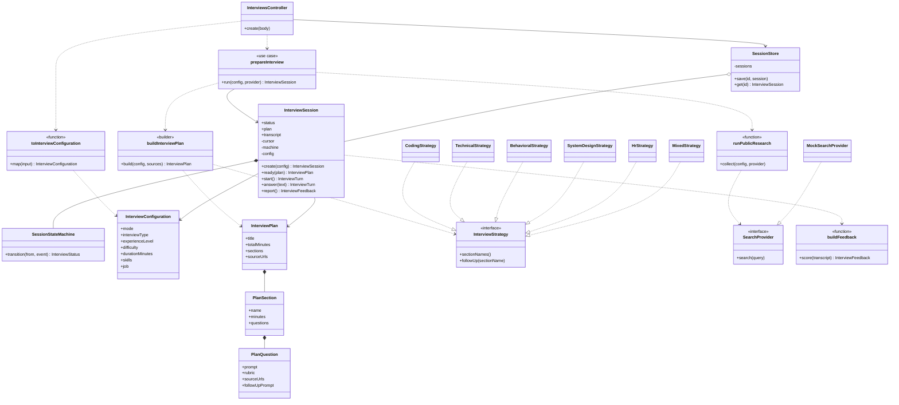

# PracticeRoom interview low-level design

This document matches the code in `apps/api/src/interviews` and `packages/shared-types`. The folder split into `domain`, `application`, and `infrastructure` is the target layout. Those folders are not created yet.

## Layers as they run today

```text
check scripts and, later, Nest controllers
        |
InterviewSession
        |
        +-- SessionStateMachine
        +-- runPublicResearch --> SearchProvider
        +-- buildInterviewPlan
        +-- firstQuestion / nextTurn
        +-- buildFeedback
```

`InterviewSession` is the aggregate. Its public methods are `create`, `ready`, `start`, `answer`, and `report`. The constructor is private. Callers use `InterviewSession.create`. `prepareInterview` is the use case that searches, builds the plan, and calls `ready`.

## Class diagram



`InterviewSession` owns the state machine. `SessionStore` keeps many sessions by id. `prepareInterview` creates the session, collects pages through `SearchProvider`, and builds the plan through the strategy. The six interview classes implement `InterviewStrategy`. `MockSearchProvider` is the only search adapter.

`status`, `plan`, and `transcript` are readable. `cursor`, the state machine, and the configuration are private. Callers do not change status by assigning a string.

## Status machine

Implemented in `session-state.ts`.

| From | Event | To |
|---|---|---|
| `draft` | `prepare` | `preparing` |
| `preparing` | `plan_ready` | `ready` |
| `preparing` | `fail` | `failed` |
| `ready` | `start` | `live` |
| `ready` | `fail` | `failed` |
| `live` | `end` | `completed` |
| `live` | `fail` | `failed` |
| `completed` | `report_ready` | `report_ready` |

`report_ready` and `failed` have no outgoing events. Any other pair throws `Cannot ${event} while the interview is in ${from} state`.

`ready` performs two transitions in one call: `prepare`, then `plan_ready`. `answer` emits `end` only when the interviewer says the interview is done. `report` emits `report_ready`.

## Configuration

`toInterviewConfiguration` accepts `JobInterviewInput` or `SkillInterviewInput`.

- Duration of 0 or less throws `Duration must be greater than 0`.
- Job mode trims company, role, and description. Any empty value throws `Company, role, and description are required`. `skills` is `[]`. `focusAreas` defaults to `[]`.
- Skill mode trims each skill and drops blanks. An empty result throws `At least one skill is required`. There is no `job` field.

## Research

`buildResearchQueries` returns `[]` unless `mode` is `job` and `job` is present.

For a job, the subject is:

```text
${company} ${role} ${round} interview experience
```

The round, including its leading space, is omitted when the candidate did not set one. Each site query appends `site:` and a bare domain, with no space after the colon. Example:

```text
Google Software Engineer Technical interview experience site:reddit.com
```

Sites and domains in code:

| Platform key | Domain |
|---|---|
| `leetcode` | `leetcode.com` |
| `glassdoor` | `glassdoor.com` |
| `geeksforgeeks` | `geeksforgeeks.org` |
| `medium` | `medium.com` |
| `reddit` | `reddit.com` |
| `linkedin` | `linkedin.com` |
| `AmbitionBox` | `ambitionbox.com` |
| `ziprecruiter` | `ziprecruiter.com` |
| `stackoverflow` | `stackoverflow.com` |
| `github` | `github.com` |
| `IGotAnOffer` | `igotanoffer.com` |
| `Blind` | `blind.com` |
| `CareerCup` | `careercup.com` |
| `company_site` | no `site:` operator |

The company-site query is the company name, the words `official carrers engineering blog`, the role, and `interview`. The spelling `carrers` is what the code sends today.

`runPublicResearch` calls `provider.search` for every query with `Promise.allSettled`. A rejected search is skipped. Fulfilled pages are appended. A URL already seen is skipped. `result.value` is read only when `result.status` is `"fulfilled"`.

`MockSearchProvider.search` returns one page per query. The URL is `https://example.com/${platform}`. The excerpt says the page is public preparation material.

## Plan

`buildInterviewPlan` chooses three section names from the interview type and splits `durationMinutes`.

```text
base = floor(durationMinutes / 3)
remainder = durationMinutes % 3
```

The first sections get `base` minutes. The last section gets `base + remainder`. A 45-minute plan is 15, 15, 15. A 40-minute plan is 13, 13, 14.

The title is `${role} at ${company}` for a job and the skills joined by `", "` for a skill interview. Each section has one question. `sourceUrls` on that question are the first two research URLs. The plan also keeps the full URL list. Prompts tell the candidate to use the job requirements and the public preparation sources.

## Turns

`InterviewCursor` is `{ sectionIndex, followUpUsed }`, starting at section 0 with `followUpUsed` false.

`firstQuestion` returns the first section's prompt and `done: false`. `start` pushes that prompt onto the transcript with `answer: ""`.

`nextTurn` measures `answer.trim().length`.

- Shorter than 40 characters, and this section has not used its follow-up: stay on the section, set `followUpUsed`, ask `Go deeper on ${section}. Add an example.`
- Otherwise advance `sectionIndex` by 1 and clear `followUpUsed`.
- If the next index is past the last section, return `done: true` and the prompt `That completes the interview.` That closing turn is not pushed onto the transcript.

`answer` writes the text onto the last transcript row before asking for the next turn. It throws `The interview is not live` unless status is `live`. `start` throws `Prepare the interview before starting` when `plan` is null.

## Feedback

`buildFeedback` keeps rows whose trimmed answer length is greater than 0. If none remain, it throws `Cannot score an interview with no answers`.

A remaining answer is short when its raw length is under 40, and developed otherwise. If short rows outnumber developed rows, the score is 40 and confidence is `low`. Otherwise the score is 80 and confidence is `high`. The same score and confidence are copied onto all five criteria. `evidence` is the trimmed text of the first short answer, or the first developed answer when the report is not mostly short.

Criteria, in order:

1. `technical_accuracy`
2. `problem_solving`
3. `communication_clarity`
4. `answer_relevance`
5. `completeness`

`strengths` lists `Developed answer in ${section}.` for each developed row. `improvements` lists `Expand the answer in ${section}.` for each short row. `practiceTopics` lists those short-answer section names.

`report` calls `buildFeedback` only when status is `completed`, then moves to `report_ready`. Any other status throws `Finish the interview before generating a report`.

## Object model

```text
InterviewSession
  status: InterviewStatus
  plan: InterviewPlan | null
  transcript: TranscriptEntry[]
  cursor: InterviewCursor          private
  machine: SessionStateMachine     private
  config: InterviewConfiguration   private

InterviewPlan
  title, totalMinutes, sourceUrls
  sections: PlanSection[]
    name, minutes
    questions: PlanQuestion[]
      prompt, rubric, sourceUrls

InterviewFeedback
  overallScore
  criteria: FeedbackCriterion[]
  strengths, improvements, practiceTopics
```

Shared types live in `packages/shared-types/src/interview.ts` and are re-exported from `index.ts`. `TranscriptEntry`, `InterviewCursor`, and `InterviewTurn` are declared next to the session and the interviewer because they are engine values, not form inputs.

## Patterns

- **State.** `SessionStateMachine.transition` is the only status writer.
- **Port and adapter.** `SearchProvider` is the port. `MockSearchProvider` is the adapter.
- **Builder.** `buildInterviewPlan` assembles sections from the interview type and the duration.
- **Factory.** `InterviewSession.create` hides the constructor.

## Target change

`PrepareInterview` should take the configuration and a `SearchProvider`, run research, build the plan, and pass that plan into the session. The session method that accepts the plan should only move `draft` to `ready`. Until that move, `InterviewSession.prepare` remains the coordinator, which is why the session file imports `runPublicResearch` and `buildInterviewPlan`.

## Checks

| File | Proves |
|---|---|
| `session-state.check.ts` | Legal moves pass and illegal moves throw |
| `configuration.check.ts` | Both forms, trimming, and required fields |
| `research.check.ts` | Site queries, round spacing, no skill-mode queries |
| `research-service.check.ts` | All pages, a failed platform, duplicate URLs, skill mode |
| `plan.check.ts` | Titles, minute totals, source URLs |
| `interviewer.check.ts` | Follow-up once, then advance, then done |
| `feedback.check.ts` | Scores 40 and 80, quoted evidence, blank answer throws |
| `interview-session.check.ts` | Full path through `report_ready` |

Run a check with:

```powershell
node --experimental-strip-types apps/api/src/interviews/<file>.check.ts
```
